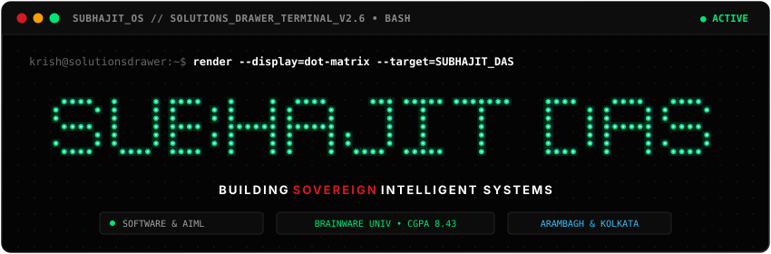

<div align="center">



<br><br>

```text
  ●●●●    ●   ●   ●●●●    ●   ●   ●●●●       ●●●   ●●●●●   ●●●●●      ●●●●     ●●●     ●●●● 
 ●    ●   ●   ●   ●   ●   ●   ●  ●    ●       ●      ●       ●        ●   ●   ●   ●   ●    ●
 ●        ●   ●   ●   ●   ●   ●  ●    ●       ●      ●       ●        ●   ●  ●     ●  ●     
  ●●●●    ●   ●   ●●●●    ●●●●●  ●●●●●●       ●      ●       ●        ●   ●  ●●●●●●●   ●●●● 
      ●   ●   ●   ●   ●   ●   ●  ●    ●   ●   ●      ●       ●        ●   ●  ●     ●       ●
 ●    ●   ●   ●   ●   ●   ●   ●  ●    ●   ●   ●      ●       ●        ●   ●  ●     ●  ●    ●
  ●●●●     ●●●    ●●●●    ●   ●  ●    ●    ●●●     ●●●●●     ●        ●●●●   ●     ●   ●●●● 
```

[](#)
[](#)
[_•_CGPA_8.43-38bdf8?style=for-the-badge&logo=academia&logoColor=black)](#)
[](#)

<br>

<p align="center">
  <strong>Building Sovereign Intelligent Systems • Local-First Android Architecture • Zero-Trust Cloud Platforms</strong>
</p>

<p align="center">
  <a href="https://letusfindrr.pages.dev"></a>
  <a href="https://mydrawer.pages.dev"></a>
  <a href="https://findrrsubhajit.substack.com"></a>
  <a href="https://www.linkedin.com/in/findrrsubhajit/"></a>
  <a href="https://canva.link/cpc3vxhkdja03dc"></a>
</p>

</div>

---

## ● About Me

I am a **Software Engineer & AIML Architect** pursuing my **B.Tech in Computer Science & Engineering (AIML)** at **Brainware University, Kolkata (2025–2029)** with a current CGPA of **8.43 / 10.0**. Based out of Arambagh & Kolkata, West Bengal, India.

- **On-Device Sovereign Software:** Engineering privacy-first applications with zero telemetry, zero SMS scraping, and 100% on-device SQLite storage.
- **Zero-Knowledge Cryptography:** Architecting client-side encrypted systems using AES-256-GCM and offline recovery passphrases.
- **Sub-1MB Edge AI / Micro NLU:** Designing deterministic natural language understanding engines under 1MB that execute locally with sub-10ms latency and zero cloud API fees.
- **Distributed Edge & Cloud:** Building distributed systems with Cloudflare Pages/Workers (V8 isolates) and serverless PostgreSQL.

> *"I refuse to let today's work wait for a future that isn't promised."*

---

## ● Flagship Projects

### 🛡️ [01. FINDRR](https://github.com/subhajit-io/Findrr) — 100% On-Device Financial Discipline Vault
> **Live Web:** [letusfindrr.pages.dev](https://letusfindrr.pages.dev) • **Architecture Spec:** [github.com/subhajit-io/Findrr](https://github.com/subhajit-io/Findrr)
- **Local-First SQLite Engine:** Complete financial transactions and budgets live exclusively on your phone with zero SMS scraping and zero remote telemetry.
- **Lyra Micro-AI Assistant:** Sub-1MB on-device NLU engine querying local SQLite in **<8ms** with zero cloud API token fees.
- **Arena Multiplayer Kingdoms:** Income-equalized financial RPG where players conquer 50 virtual territories based on a normalized **Discipline Score**.
- **Tech Stack:** Android (Jetpack Compose M3), Room (SQLite), Kotlin Coroutines, AES-256-GCM, Razorpay UPI SDK.

### 📦 [02. SOLUTIONS DRAWER](https://mydrawer.pages.dev/) — Sovereign Android App Store & PWA Platform
> **Live Web:** [mydrawer.pages.dev](https://mydrawer.pages.dev/)
- **Bypassing App Monopolies:** Minimalist web application catalog and WebAPK distributor eliminating invasive corporate surveillance and tracking.
- **Drawer Protect Engine:** Client-side binary SHA-256 validation ensuring zero-compromise application delivery.
- **Tech Stack:** Next.js 16, TypeScript, Cloudflare D1 Edge SQLite, Cloudflare Pages, AWS S3 Presigned.

### 🚀 03. LAUNUP — Zero-URL Software Discovery & Founder Launchpad
> *Status: Active Preview • Launching Soon*
- **"You tell your problems. We'll handle the rest."**
- Zero-URL problem-first software discovery platform where users test sandboxed tools directly via `@handle.launup` sovereign handles.
- **Tech Stack:** Next.js 15, Solutions Drawer Unified Identity, PBKDF2-SHA512, Client Sandboxes.

---

## ● Collaborative Ventures & Startups

### 🎓 [UCAP](https://github.com/subhajit-io) — Social Learning & Real-Time Mentorship
- **Role:** Co-Founder & Full-Stack Architect *(with Shusovan Dutta)*
- **Overview:** Virtual classrooms combining Jitsi WebRTC video, Monaco IDE live code execution, and interactive whiteboards.
- **Tech Stack:** Next.js 16, NestJS, Supabase (PostgreSQL + RBAC), Monaco Editor, WebRTC.

### 🏛️ [Memento](https://sih-26-memento-teal.vercel.app/) — Smart India Hackathon (SIH 2026)
- **Role:** Co-Engineer & Platform Developer *(Problem Statement 43)*
- **Team:** Sambu Chowdhury, Rana Tarafdar, Mousumi Bag, Yuvraj Shaw, Masum Aktar, Subhajit Das
- **Overview:** Jharkhand state civic innovation portal connecting citizen community grievances to university HEIs for research-driven resolution.
- **Tech Stack:** Next.js, React, Civic Tech, AI Routing, Tailwind CSS.

### 🛡️ [Zuard](https://zuard-topaz.vercel.app/) — Brand Governance & Pre-Screening Engine
- **Role:** Co-Engineer & AI Pipeline Architect
- **Team:** Sambu Chowdhury, Mousumi Bag, Rana Tarafdar, Subhajit Das
- **Overview:** Deterministic brand compliance pre-screening engine with sub-5ms static AST workers, OpenCV WCAG contrast, and zero-hallucination multimodal RAG.
- **Tech Stack:** Python, FastAPI, asyncio, SQLite, OpenCV, RAG, PyMuPDF.

---

## ● Technical Toolkit & Stack

<table>
  <tr>
    <td width="50%" valign="top">
      <h4>● AI, Machine Learning & NLU</h4>
      <ul>
        <li><strong>Local LLMs:</strong> Qwen 2.5 Coder, Llama 3, Ollama, LM Studio</li>
        <li><strong>RAG Pipelines:</strong> Multimodal RAG, Vector Search, Page Citations</li>
        <li><strong>Core Frameworks:</strong> PyTorch, NumPy, Hugging Face, BPE Tokenizers</li>
        <li><strong>Methodologies:</strong> Deterministic Intent Classifiers, Prompt Engineering</li>
      </ul>
      <h4>● Programming Languages</h4>
      <ul>
        <li><strong>Primary:</strong> Kotlin, Python, TypeScript, C++, C</li>
        <li><strong>Secondary:</strong> Java, Dart (Flutter), JavaScript, Modern SQL</li>
      </ul>
    </td>
    <td width="50%" valign="top">
      <h4>● Web, Edge & Distributed Cloud</h4>
      <ul>
        <li><strong>Frontend:</strong> Jetpack Compose (Material 3), Next.js 15/16, React</li>
        <li><strong>Edge Cloud:</strong> Cloudflare Pages, Workers, V8 Isolates, Vercel</li>
        <li><strong>Databases:</strong> Room (SQLite), Cloudflare D1, Neon PostgreSQL, Supabase</li>
        <li><strong>Payment Infra:</strong> Razorpay Native Android SDK, UPI Intent Routing</li>
      </ul>
      <h4>● Workstations & Developer Tooling</h4>
      <ul>
        <li><strong>Environments:</strong> Antigravity IDE, Android Studio, VS Code, Linux CLI</li>
        <li><strong>Version Control:</strong> Git, GitHub Actions, Scoped Storage API</li>
      </ul>
    </td>
  </tr>
</table>

---

## ● GitHub Activity & Metrics

<div align="center">


<br>


</div>

---

## ● Contact & Connect

<div align="center">

[](mailto:subhajit32das@gmail.com)
[](https://www.linkedin.com/in/findrrsubhajit/)
[](https://wa.me/917001023356)
[](https://findrrsubhajit.substack.com)
[](https://solutionsdrawer.pages.dev)
[](https://canva.link/cpc3vxhkdja03dc)

<br>
<sub>Designed with the Solutions Drawer Industrial Minimalist Identity • Engineered by Subhajit Das</sub>

</div>
